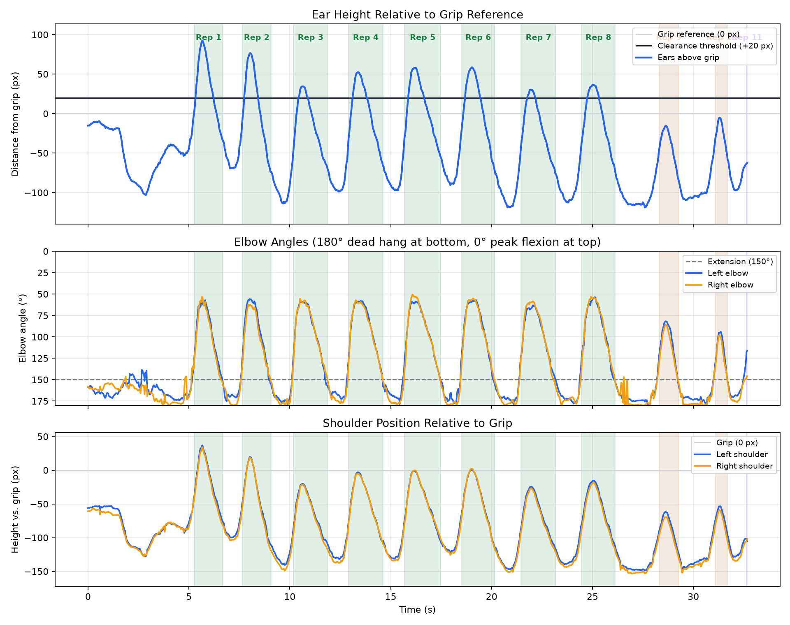

# Pull-Up Vision

[Español](README.md) | **English**

A local prototype for analyzing pull-up videos. It uses **YOLO11-pose** to estimate body keypoints, then calculates elbow angles, detects repetition cycles, and creates a visual report.



> This is an experimental project, not a medical tool or a reliable assessment of athletic technique.

## Get started

You need Python 3.11 or later and [`uv`](https://docs.astral.sh/uv/). To export an MP4 video, you also need `ffmpeg`.

```bash
uv sync
```

Add a video to `data/raw/`, then run:

```bash
# Analyze the first video in data/raw/
uv run python src/main.py

# Or choose a specific video
uv run python src/main.py data/raw/my-set.mp4

# Also export an MP4 dashboard
uv run python src/main.py data/raw/my-set.mp4 --export-mp4
```

On the first run, Ultralytics automatically downloads the `yolo11m-pose.pt` weights. To use different weights, pass `--weights PATH`.

## What it does

YOLO-pose estimates up to 17 body keypoints per frame; it does not detect the bar or the chin. The project calculates elbow angles and uses their changes to detect repetition cycles. To grade a repetition, it compares ear height—the closest available proxy for chin height—with a grip reference estimated from the wrists:

- **`complete`**: the cycle returns to extension, and the ears rise at least 25 pixels above the reference.
- **`partial`**: the cycle returns to extension but does not reach that height.
- **`no_extension`**: a cycle starts, but a return to extension is not observed before the video ends.

ROM is an indicative measure based on a reference range from 180° to 55°. If the video does not show an extended position before the cycle, ROM and ascent time are left blank rather than estimated.

## Output

Files are saved to `data/processed/<video-name>/`:

- `viewer.html`: interactive viewer with video, skeleton, and charts.
- `summary.json` and `summary.csv`: session summary.
- `repetitions.csv`: per-cycle metrics, including grade, ROM, and timings.
- `keypoints.csv` and `elbow-angles.csv`: estimated keypoints and per-frame angles.
- PNG charts; the MP4 dashboard is only created with `--export-mp4`.

Open the viewer on macOS:

```bash
open data/processed/my-set/viewer.html
```

## Limitations

Thresholds are experimental, and the 25-pixel threshold depends on framing and resolution. The analysis is intended for videos with one visible person: it selects the highest-confidence detection in each frame but does not track a person's identity across frames.

In a manual evaluation of 34 repetitions across 6 recordings, keypoint noise and camera perspective made subtle asymmetries difficult to distinguish from clean movements. The angles and charts are therefore useful for exploring movement, not certifying technique. Reference labels are available in [`data/labels/manual-repetition-labels.csv`](data/labels/manual-repetition-labels.csv).

## Development

Analysis thresholds are set in [`src/config.py`](src/config.py). Run the tests and linter with:

```bash
uv run --group dev python -m pytest
uv run --group dev ruff check src tests
```

Input videos, generated outputs, and model weights are kept out of Git.

Inspired by [Jeremy Park](https://github.com/jeremyipark/vision-demos/tree/main/pull_ups). Released under the [MIT License](LICENSE).
