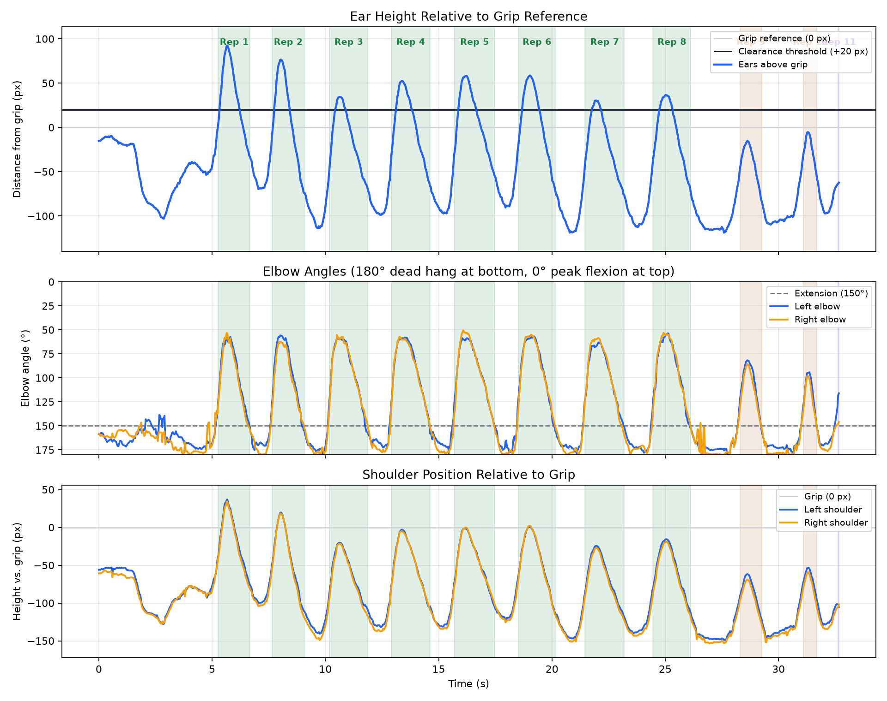

# Pull-Up Vision

Prototipo local para analizar vídeos de dominadas. Usa **YOLO11-pose** para estimar los puntos del cuerpo y, a partir de ellos, calcular ángulos de codo, detectar ciclos y generar un visor con resultados.



> Es un proyecto experimental, no una herramienta médica ni una evaluación fiable de la técnica deportiva.

## Empezar

Necesitas Python 3.11 o superior y [`uv`](https://docs.astral.sh/uv/). Para exportar el vídeo MP4 también necesitas `ffmpeg`.

```bash
uv sync
```

Pon un vídeo en `data/raw/` y ejecuta:

```bash
# Analiza el primer vídeo de data/raw/
uv run python src/main.py

# O indica un vídeo concreto
uv run python src/main.py data/raw/mi-serie.mp4

# Añade también un panel de vídeo MP4
uv run python src/main.py data/raw/mi-serie.mp4 --export-mp4
```

La primera vez se descargan automáticamente los pesos `yolo11m-pose.pt`. Puedes usar otros pesos con `--weights RUTA`.

## Qué hace

YOLO-pose estima hasta 17 puntos del cuerpo por fotograma; no detecta la barra ni la barbilla. El proyecto calcula los ángulos de los codos y usa sus cambios para detectar los ciclos. Para clasificar una repetición, compara la altura de las orejas —una aproximación de la barbilla— con una referencia estimada a partir de las muñecas:

- **`complete`**: el ciclo vuelve a extensión y las orejas superan la referencia al menos 25 píxeles.
- **`partial`**: vuelve a extensión, pero no alcanza esa altura.
- **`no_extension`**: el ciclo empieza, pero no se observa el regreso a extensión antes de acabar el vídeo.

El ROM es una referencia orientativa basada en un recorrido de 180° a 55°. Si el vídeo no muestra una posición extendida antes del ciclo, el proyecto no estima el ROM ni el tiempo de subida.

## Resultados

Los archivos se guardan en `data/processed/<nombre-del-vídeo>/`:

- `viewer.html`: visor interactivo con vídeo, esqueleto y gráficas.
- `summary.json` y `summary.csv`: resumen de la sesión.
- `repetitions.csv`: métricas de cada ciclo, incluyendo clasificación, ROM y tiempos.
- `keypoints.csv` y `elbow-angles.csv`: puntos estimados y ángulos por fotograma.
- Gráficas PNG; el panel MP4 se genera solo con `--export-mp4`.

Para abrir el visor en macOS:

```bash
open data/processed/mi-serie/viewer.html
```

## Límites

Los umbrales son experimentales y el de 25 píxeles depende del encuadre y la resolución. El análisis está pensado para vídeos con una sola persona visible: el sistema elige la detección con mayor confianza en cada fotograma, pero no sigue la identidad de una persona entre fotogramas.

En una evaluación manual de 34 repeticiones de 6 grabaciones, el ruido de los keypoints y la perspectiva de la cámara dificultaron distinguir asimetrías sutiles de movimientos limpios. Por eso, los ángulos y las gráficas sirven para explorar el movimiento, no para certificar la técnica. Las etiquetas de referencia están en [`data/labels/manual-repetition-labels.csv`](data/labels/manual-repetition-labels.csv).

## Desarrollo

Los umbrales se configuran en [`src/config.py`](src/config.py). Para ejecutar las pruebas y el linter:

```bash
uv run --group dev python -m pytest
uv run --group dev ruff check src tests
```

Los vídeos de entrada y resultados, además de los pesos del modelo, se mantienen fuera de Git.

Inspirado por [Jeremy Park](https://github.com/jeremyipark/vision-demos/tree/main/pull_ups). Publicado bajo licencia [MIT](LICENSE).
