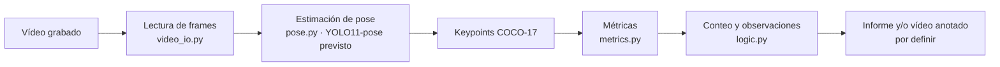

# juez-dominadas

Proyecto personal de visión por computador para analizar vídeos de **dominadas**, contar repeticiones y ofrecer observaciones útiles sobre la técnica. La idea es grabarme en el gimnasio y usar estimación de pose para estudiar principalmente el ángulo de los codos y si la barbilla supera la barra.

> **Estado: andamiaje inicial.** Todavía no hay grabaciones propias ni un pipeline ejecutable. Las funciones principales están sin implementar; este README describe el objetivo y un diseño de trabajo, no resultados ya disponibles.

## Objetivo

Para una grabación de una serie de dominadas, el proyecto pretende:

- Detectar la pose frame a frame y contar las repeticiones según criterios explícitos.
- Evaluar aspectos observables de la técnica, empezando por extensión/flexión de codos y altura de la barbilla respecto a la barra.
- Señalar diferencias persistentes entre lados como **posible asimetría** que conviene revisar.
- Generar, más adelante, un resumen legible y posiblemente un vídeo anotado.

La idea es una herramienta de análisis y aprendizaje, no un sistema médico ni una forma de diagnosticar debilidad o descompensación muscular. Una asimetría aparente también puede deberse al ángulo de cámara, oclusiones o errores del estimador.

## Diseño previsto



La intención es aislar el modelo de pose detrás de `pose.py` y mantener las métricas y reglas de evaluación separadas de la lectura de vídeo. Así se podrán probar con datos sintéticos sin cargar un modelo.

### Métricas: límites que hay que resolver

- **Ángulo del codo:** se puede calcular con hombro–codo–muñeca por lado. En COCO-17 son los índices `5/6` (hombros), `7/8` (codos) y `9/10` (muñecas). El ángulo y los umbrales todavía no están validados con grabaciones.
- **Barbilla sobre la barra:** COCO-17 incluye la nariz (índice `0`), pero no la barbilla ni la barra. La nariz es solo un posible proxy, no una medida exacta; habrá que decidir cómo localizar o calibrar la barra y cómo tratar la incertidumbre.
- **Simetría:** comparar puntos o ángulos izquierdo/derecho puede revelar una diferencia visible, pero la vista de cámara puede ocultar o distorsionar un lado. La posición de cámara y la utilidad de una vista frontal/lateral quedan por probar.
- **Conteo:** se plantea detectar el ciclo de subida y bajada con criterios de inicio y final de repetición; definir qué cuenta como repetición completa y validar el resultado contra un conteo manual sigue pendiente.

No se debe dar por hecho que existe detección de barra, filtro temporal, puntuación, detección de impulso o una máquina de estados implementada: son opciones de diseño para fases posteriores.

## Estructura actual

```text
data/
├── raw/                       # Grabaciones de entrada; ignoradas por Git
└── processed/                # Salidas futuras; ignoradas por Git
src/juez_dominadas/
├── __init__.py               # Paquete y versión
├── video_io.py               # Interfaz prevista para leer/escribir vídeo
├── pose.py                   # Interfaz prevista para estimación de pose
├── metrics.py                # Métricas geométricas
├── logic.py                  # Conteo y valoración
└── config.py                 # Umbrales provisionales
tests/
└── test_logic.py             # Por ahora solo prueba la importación del paquete
AGENTS.md
README.md
pyproject.toml
.gitignore
```

El paquete usa el layout `src/`. `pyproject.toml` declara Python `>=3.11`, NumPy, OpenCV y Ultralytics como dependencias de ejecución; pytest y Ruff como dependencias de desarrollo. YOLO11-pose es la elección inicial para estimación de pose, no un modelo ya integrado.

## Preparación y comprobaciones

Se necesita [uv](https://docs.astral.sh/uv/).

```bash
uv sync
uv run pytest
uv run ruff check .
uv run ruff format --check .
```

`uv sync` instala las dependencias declaradas, incluidas las de Ultralytics, que pueden ser pesadas. Las pruebas actuales no ejecutan inferencia ni validan la lógica del ejercicio.

## Datos personales

Deja las grabaciones en `data/raw/`; cualquier salida local puede ir en `data/processed/`. El contenido de ambas carpetas y los pesos de modelos están excluidos de Git. No subas grabaciones personales ni pesos al repositorio.

## Próximos pasos

1. Definir condiciones de grabación y probar qué vista permite ver mejor codos, cara y barra.
2. Implementar lectura de vídeo y extracción de keypoints; registrar confianza junto a las coordenadas.
3. Validar las métricas con secuencias reales y revisar manualmente sus limitaciones.
4. Definir criterios de repetición y de observación técnica; probarlos contra anotaciones manuales.
5. Elegir el formato del informe y decidir si hace falta generar un vídeo anotado o una CLI.

Antes de asignar puntuaciones o etiquetas de técnica, se deben documentar los criterios y calibrarlos con ejemplos reales. Los valores iniciales de `config.py` son solo provisionales.

## Decisiones pendientes

- Posición y número de vistas de cámara; condiciones mínimas de grabación.
- Cómo obtener la referencia de la barra y cómo evaluar el cruce de barbilla sin un keypoint directo.
- Criterios exactos para contar repeticiones completas y parciales.
- Qué observaciones se mostrarán y cómo expresar incertidumbre sin convertir asimetrías en diagnósticos.
- Formato de salida y si el primer uso será por script, CLI u otra interfaz.

`pyproject.toml` declara licencia MIT, pero todavía no hay un archivo `LICENSE`.
